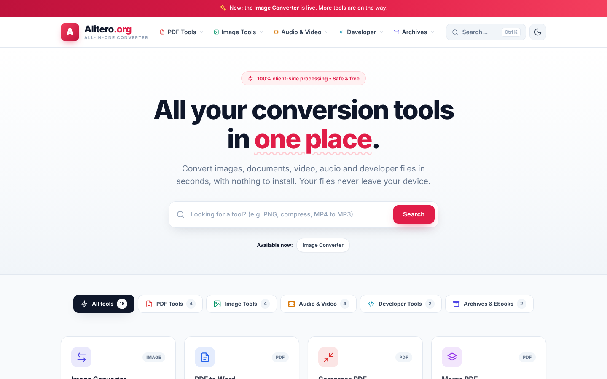
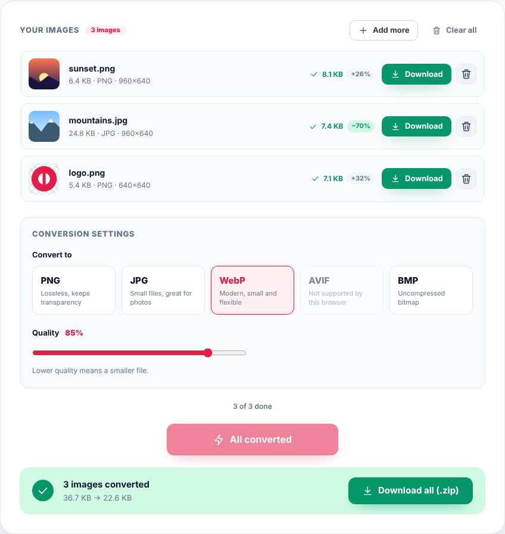
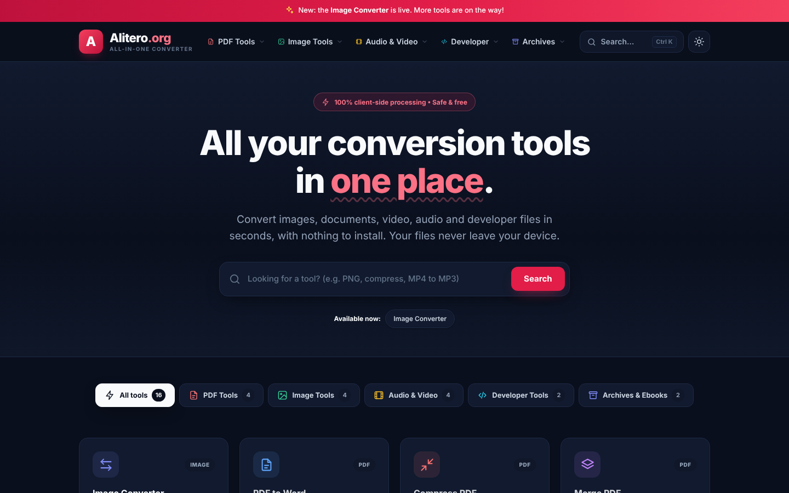
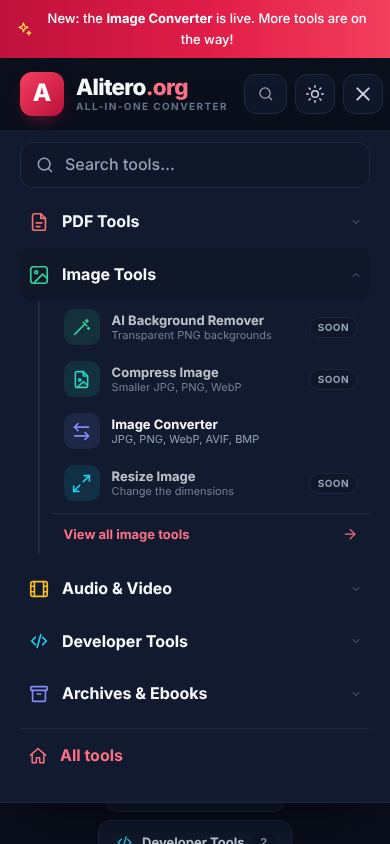

# Alitero

**An all-in-one conversion hub that runs entirely in your browser.**
Pick a tool, drop in your files, get the result. Nothing is uploaded, nothing is installed.



> **Status:** in active development. The site is not deployed to its own domain yet. The **Image Converter** is fully working today; the other tools are listed in the hub as "coming soon".

---

## Highlights

- **Tool hub, iLovePDF style**: a searchable, filterable grid of tools grouped by category (PDF, Image, Audio & Video, Developer, Archives & Ebooks).
- **Real image converter**: PNG, JPG, WebP, AVIF and BMP, with quality control, background colour for transparent images, batch conversion and one-click ZIP download.
- **100% client-side**: files are processed with the browser's Canvas API and never leave the device.
- **Zero dependencies, zero build step**: plain HTML, CSS and vanilla JavaScript. Open `index.html` and it works, even from `file://`.
- **Data-driven**: add one object to a registry and the new tool appears in the menus, the grid, the search and the footer automatically.
- **Light and dark theme** with no flash on load, remembered between visits.
- **Responsive and accessible**: dropdown navigation on desktop, hamburger menu on mobile, keyboard-friendly search (`Ctrl/⌘ + K`), skip link, ARIA labels.
- **Fully commented code** with every concern in its own file.

## Screenshots

| Image Converter | Dark theme |
| :---: | :---: |
|  |  |

| Mobile menu |
| :---: |
|  |

## The Image Converter

| Feature | Details |
| --- | --- |
| Input formats | PNG, JPG/JPEG, WebP, GIF (first frame), BMP, AVIF (where the browser can decode it) |
| Output formats | PNG, JPG, WebP, AVIF, BMP |
| Quality | Adjustable slider for lossy formats |
| Transparency | PNG/WebP keep alpha; JPG/BMP are filled with a background colour you choose |
| Batch | Up to 20 files at once, 25 MB each, up to 100 megapixels per image |
| Download | Single files or everything as one `.zip` (duplicate names are handled: `pic.jpg`, `pic (2).jpg`) |
| Input methods | File picker, drag and drop, or paste from the clipboard |
| Browser support | Output formats are detected at runtime, so unsupported ones (for example AVIF in some browsers) are disabled with an explanation instead of failing |
| Persistence | Your last settings are remembered in `localStorage` |

### How it works

```
File ──► createImageBitmap() ──► <canvas> ──► canvas.toBlob() ──► Blob ──► download / ZIP
         (decode)                 (draw, fill   (encode; BMP uses
                                   background)   a custom encoder)
```

The engine lives in a single file, `assets/js/converters/image-converter.js`, and has no DOM code, so it can be reused by any page:

```js
const result = await Alitero.ImageConverter.convert(file, {
  format: 'webp',        // 'png' | 'jpg' | 'webp' | 'avif' | 'bmp'
  quality: 0.85,         // 0.1 – 1, used by lossy formats
  background: '#ffffff'  // used when the target format has no alpha
});

// result → { blob, name, ext, mime, width, height, size }
```

ZIP creation (store-only, with CRC-32) is a separate, dependency-free module: `Alitero.Zip.create([{ name, blob }])` returns a `Promise<Blob>`.

## Tech stack

| Layer | Choice |
| --- | --- |
| Markup | HTML5, semantic elements |
| Styling | Plain CSS with custom properties (design tokens, light/dark themes) |
| Logic | Vanilla JavaScript (ES5-style IIFEs, one global namespace: `window.Alitero`) |
| Icons | Inline SVG library (`icons.js`), no icon fonts |
| Font | Inter via Google Fonts |
| Image processing | Canvas API, `createImageBitmap` |
| Build tools | None |

## Getting started

No installation is required.

**Option 1: open the file.** Double-click `index.html`.

**Option 2: use any static server** (recommended for development):

```bash
# Node
npx serve .

# or with VS Code: install the "Live Server" extension and click "Go Live"
```

Then visit the address printed in the terminal.

## Adding a new tool

1. Add an entry to `TOOLS` in `assets/js/core/tools-data.js`:

   ```js
   {
     id: 'compress-image', category: 'image', status: 'live',  // 'soon' shows a "Soon" badge
     url: 'compress-image.html',
     title: 'Compress Image', tagline: 'Smaller JPG, PNG, WebP',
     description: 'Optimise images for faster loading without visible quality loss.',
     formats: 'JPG, PNG, WebP', icon: 'file-image', tone: 'teal', badge: 'IMAGE',
     keywords: 'image compress reduce size optimize jpg png webp photo'
   }
   ```

2. Create the page (copy `image-converter.html`) and its script in `assets/js/pages/`.
3. Put the processing logic in `assets/js/converters/`.

The menus, the home grid, the search results and the footer update on their own.

## Privacy

Conversions happen on your device. There are no uploads, no accounts, no analytics and no cookies. The only external request is the Inter font from Google Fonts.

## Contact form

The site has no backend, so the contact form validates the input and opens the visitor's own email app with a pre-filled message (`mailto:`). The destination address is set in `assets/js/core/config.js`. Because there is no server, the form has no CAPTCHA; add server-side verification if you later move to a real form endpoint.

## Architecture plan

The front end stays static. Image tools run in the browser, as they do today. Tools that cannot run client-side (PDF, audio and video processing and similar) will be handled by a **PHP backend** behind a small API, which the existing tool pages will call. Nothing in the current front end has to change for this: each new tool is still one registry entry, one page and one script.

## Roadmap

- [x] Tool hub with search, categories, dropdown and mobile navigation
- [x] Light and dark theme
- [x] Image Converter (PNG, JPG, WebP, AVIF, BMP) with batch and ZIP
- [x] Contact page
- [ ] Compress and Resize Image
- [ ] PHP backend for the server-side tools
- [ ] PDF tools: merge, split, compress, PDF to Word
- [ ] Audio and video: MP4 to MP3, video to GIF, converters
- [ ] Developer tools: JSON to CSV, QR generator
- [ ] Archives and ebooks: ZIP extractor, EPUB to PDF
- [ ] Deploy to the Alitero.org domain

## Browser support

Current versions of Chrome, Edge, Firefox and Safari. AVIF output depends on the browser's encoder; the converter detects this and disables the option when it is not available.

## License

Released under the [MIT License](LICENSE).